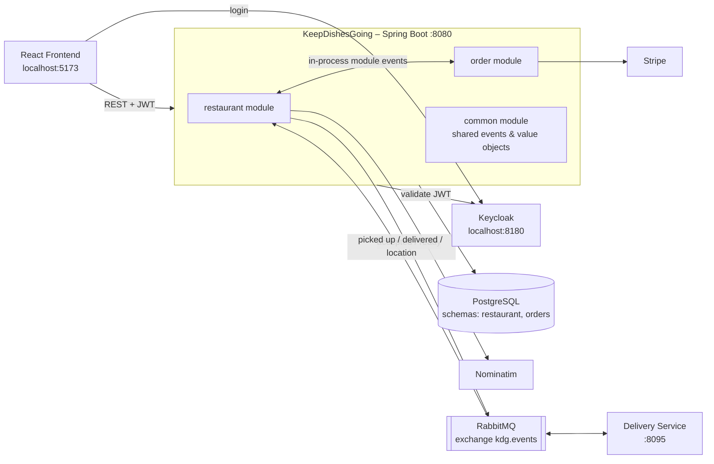
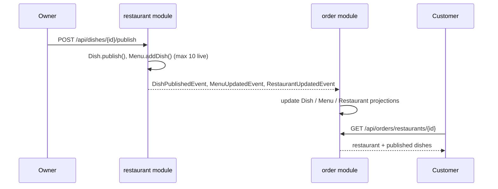
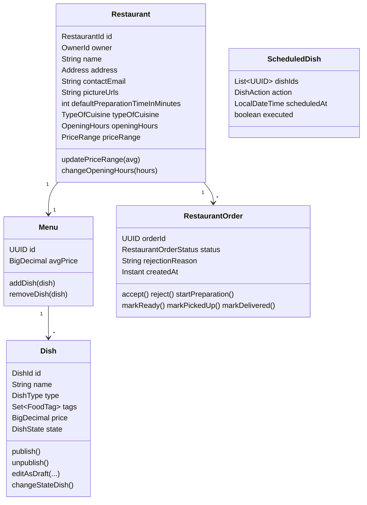
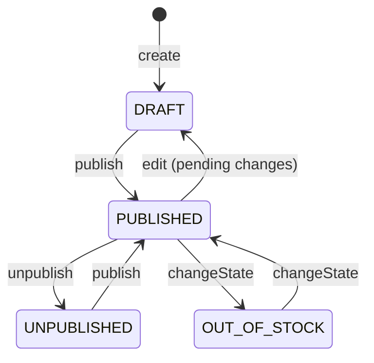
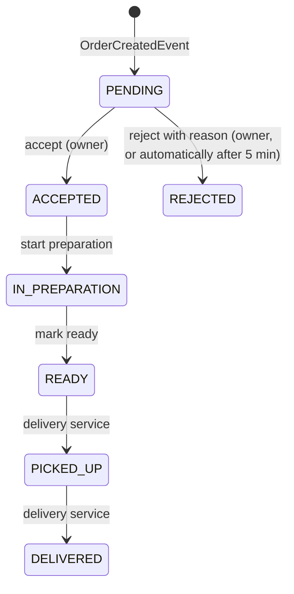
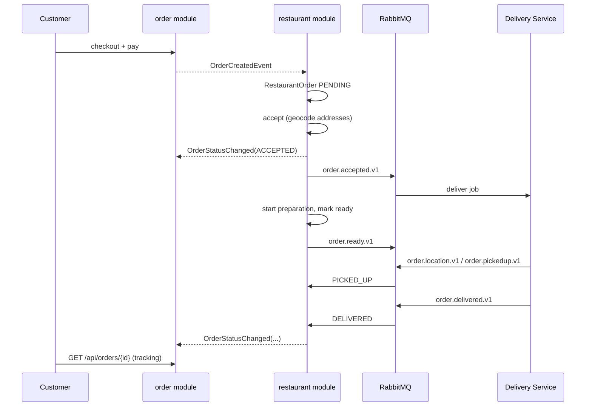

# KeepDishesGoing – Backend Technical Documentation

**Author:** Anna Mestres
**Course:** Programming 6 – Karel de Grote University of Applied Sciences

KeepDishesGoing is the backend of a food-ordering platform that connects **restaurant owners** with **customers**. Owners manage a restaurant, its menu and the incoming orders. Customers browse restaurants, build a basket, pay with Stripe and follow the order until it is delivered. An external **Delivery Service** picks up and delivers the orders, and talks to this backend over RabbitMQ.

The backend is a **modular monolith** built with Spring Boot and Spring Modulith. It follows **Domain-Driven Design** and a **hexagonal (ports & adapters)** architecture.

---

## Table of Contents

1. [Features](#1-features)
2. [Tech Stack](#2-tech-stack)
3. [Architecture](#3-architecture)
4. [Main Components](#4-main-components)
5. [Domain Model & Business Rules](#5-domain-model--business-rules)
6. [Event-Driven Communication](#6-event-driven-communication)
7. [REST API Reference](#7-rest-api-reference)
8. [Installation & Setup](#8-installation--setup)
9. [Usage Walkthrough](#9-usage-walkthrough)
10. [Project Structure](#10-project-structure)
11. [Design Decisions](#11-design-decisions)
12. [Known Limitations](#12-known-limitations)
13. [Future Work](#13-future-work)

---

## 1. Features

### Restaurant owner (authenticated, role `owner`)

| Feature | Description |
|---|---|
| Sign up / sign in | Handled by Keycloak (OpenID Connect). The backend validates the JWT access token. |
| Create a restaurant | Name, full address, contact email, picture URLs, default preparation time, type of cuisine and opening hours per weekday. |
| Opening hours | Set or change opening hours per weekday. |
| Dish management | Create dishes (starter / main / dessert) with description, price, picture and food tags (e.g. gluten, lactose). |
| Draft editing | Editing a published dish puts it back into `DRAFT`, so the live menu does not change until the dish is published again. |
| Publish / unpublish | Put a dish on the live menu or take it off. At most **10 dishes** can be live at the same time. |
| Scheduled changes | Plan a group of publishes or unpublishes to go live together at a chosen date and time. |
| Stock management | Toggle a dish between *out of stock* and *back in stock* immediately. |
| Automatic price range | The restaurant's price range (€ to €€€€) is calculated from the average price of its menu. |
| Order management | View orders by status; accept, reject (a reason is required), start preparation, mark as ready for pickup. |
| Auto-reject | Orders without a decision within **5 minutes** are rejected automatically. |

### Customer (anonymous, no account needed)

| Feature | Description |
|---|---|
| Explore restaurants | List all restaurants (the frontend shows them in a list or on a map). |
| Filter restaurants | By type of cuisine and price range. |
| Restaurant details | View a restaurant with its menu of published dishes. |
| Filter & sort dishes | Filter by dish type and food tags; sort by price or name, ascending or descending. |
| Basket | Build a basket from **one restaurant only**; add and remove dishes and change quantities. |
| Checkout validation | Checkout is blocked if a dish in the basket was unpublished or went out of stock in the meantime. |
| Checkout | Enter name, delivery address, email and an optional message. |
| Payment | Pay through a Stripe Checkout session; the payment is verified afterwards. |
| Order tracking | Track the order by its ID (confirmation link) while the status changes: `PENDING → ACCEPTED → IN_PREPARATION → READY → PICKED_UP → DELIVERED` (or `REJECTED`). |

### Delivery service integration

- **Publishes** `order accepted` (with pickup and drop-off addresses and coordinates) and `order ready for pickup` messages.
- **Consumes** `picked up`, `delivered` and `courier location` messages and updates the order status.

---

## 2. Tech Stack

### Backend

| Area | Technology |
|---|---|
| Language | Java 21 |
| Framework | Spring Boot 3.5.6 (Web, Validation, Data JPA, Security, AMQP) |
| Modularity | Spring Modulith 1.4.1 (application modules, module events, event externalization to AMQP) |
| Persistence | PostgreSQL 17 with Hibernate / Spring Data JPA (`ddl-auto=validate`, schema created by SQL scripts) |
| Messaging | RabbitMQ 3.13 (topic exchange `kdg.events`), JSON messages via Jackson |
| Security | Spring Security OAuth2 Resource Server (JWT) with Keycloak 26.3 as identity provider |
| Payments | Stripe Java SDK 24.16 (Checkout Sessions, test mode) |
| Geocoding | OpenStreetMap Nominatim API (address → latitude/longitude) |
| Scheduling | Spring `@Scheduled` tasks |
| Build | Gradle (Kotlin DSL) with the Gradle wrapper |
| Infrastructure | Docker Compose (PostgreSQL, RabbitMQ, Keycloak + MySQL, Delivery Service) |

### Frontend (separate project, `../frontend`)

React 19, TypeScript, Vite, Material UI, TanStack React Query, Axios, React Router, React Hook Form + Zod, and `keycloak-js` for login. It runs on `http://localhost:5173`, which is the origin allowed by the backend's CORS configuration.

---

## 3. Architecture

### 3.1 High-level overview



### 3.2 Modular monolith (Spring Modulith)

The application is split into three **application modules**, which match the bounded contexts:

| Module | Bounded context | Responsibility |
|---|---|---|
| `restaurant` | Restaurant management (write side for owners) | Restaurants, menus, dishes, scheduled dish changes, the restaurant's view of orders, delivery-service integration. |
| `order` | Customer ordering | Read models (projections) of restaurants, menus and dishes, baskets, orders, payments. |
| `common` | Shared kernel (`OPEN` module) | Domain event contracts, shared value objects (`Address`, `Coordinates`, `FoodTag`, `TimeRange`) and RabbitMQ configuration. |

The modules **never call each other directly**. They only communicate through domain events defined in `common`. Each module has its own PostgreSQL schema (`restaurant` and `orders`), so each context owns its own data.

At startup the application logs the module structure detected by Spring Modulith (`KeepDishesGoingApplication#onApplicationStarted`).

### 3.3 Hexagonal architecture inside each module

Each module uses the same ports & adapters layout:

```
<module>/
├── domain/        Aggregates, entities, value objects, enums, domain exceptions (plain Java, no Spring)
├── port/
│   ├── in/        Use case interfaces + commands (what the module offers)
│   └── out/       Persistence / external-service interfaces (what the module needs)
├── core/          Use case implementations (application services, @Service, @Transactional)
└── adapter/
    ├── in/        REST controllers, event listeners, RabbitMQ listeners, scheduled jobs
    └── out/       JPA entities, repositories, mappers, event publishers, Stripe, geocoding
```

Dependencies always point inward: `adapter → port → core → domain`. The domain model knows nothing about JPA, HTTP or RabbitMQ. JPA entities are separate classes, and mappers convert between domain objects and JPA entities.

Save ports are injected as a `List<SavePort>`. Because of this, one save can run several adapters: the JPA adapter stores the aggregate and an *event publisher* adapter publishes the events the aggregate recorded (for example `DishJpaAdapter` + `DishEventPublisher`).

### 3.4 CQRS-style read models

The `order` module does not read the `restaurant` tables. It keeps its own **projections** (`RestaurantProjection`, `MenuProjection`, `DishProjection`), which are updated from events:



The customer side is therefore **eventually consistent** with the owner side. In return, the customer-facing reads are simple, fast and separate from the restaurant model.

---

## 4. Main Components

### 4.1 `restaurant` module

| Component | Type | Purpose |
|---|---|---|
| `RestaurantController` | REST | Create a restaurant, list the owner's restaurants, get by ID, set opening hours. |
| `DishController` | REST | Create, edit (draft), publish, unpublish, toggle stock, list dishes. |
| `ScheduleDishChangeController` | REST | Schedule a group of publishes or unpublishes. |
| `RestaurantOrderController` | REST | List orders by status; accept, reject, start preparation, mark ready. |
| `ScheduledDishChangeExecutor` | Scheduled job (every 60 s) | Runs scheduled publishes and unpublishes that are due. |
| `ScheduledOrderAutoRejector` | Scheduled job (every 60 s) | Rejects `PENDING` orders that are older than 5 minutes. |
| `OrderCreatedListener` | Module event listener | Creates the restaurant's copy of an order when a customer checks out. |
| `DeliveryEventsListener` | RabbitMQ listener | Handles picked up, delivered and location messages from the delivery service. |
| `GeocodingAdapter` | Outbound adapter | Gets pickup and drop-off coordinates from Nominatim when an order is accepted. |
| `*EventPublisher` | Outbound adapter | Publishes the domain events recorded by aggregates through Spring's `ApplicationEventPublisher`. |

### 4.2 `order` module

| Component | Type | Purpose |
|---|---|---|
| `RestaurantProjectionController` | REST | List, filter and view restaurants (public). |
| `DishProjectionController` | REST | Filter and sort the dishes of a restaurant (public). |
| `BasketController` | REST | Get a basket, add or remove items, check out (public). |
| `PaymentController` | REST | Create a Stripe Checkout session and verify the payment (public). |
| `OrderController` | REST | Get an order for tracking (public). |
| `RestaurantChangedListener`, `MenuChangedListener`, `DishChangedListener` | Module event listeners | Keep the read models up to date. |
| `OrderStatusChangedListener` | Module event listener | Updates the customer's order status when the restaurant or delivery service changes it. |
| `StripePaymentAdapter` | Outbound adapter | Wraps the Stripe SDK (create session, verify payment status / payment intent). |
| `PaymentStatePersistenceAdapter` | Outbound adapter | Stores the link between Stripe session and order (`PENDING` → `COMPLETED`). |

### 4.3 `common` module

- **Events:** `RestaurantCreated/UpdatedEvent`, `MenuCreated/UpdatedEvent`, `DishPublished/Unpublished/StateChangedEvent`, `OrderCreatedEvent`, `OrderStatusChangedEvent`, `OrderAcceptedEvent`, `OrderReadyForPickupEvent`, `OrderPickedUpEvent`, `OrderDeliveredEvent`, `DeliveryJobLocationUpdatedEvent`. All of them implement `DomainEvent`.
- **Value objects:** `Address`, `AddressDto`, `Coordinates`, `FoodTag`, `TimeRange`, `OrderItemDto`.
- **Config:** `RabbitMQToplogy` (exchange, queues and bindings) and `RabbitMQConfig` (JSON converter, and mapping of the delivery service's event class names to local event types).

### 4.4 `security` package

- `SecurityConfig` – a stateless JWT resource server. `/api/orders/**` and `/api/payment/**` are public; every other endpoint needs authentication. Method security (`@PreAuthorize("hasAuthority('owner')")`) protects the owner endpoints. CORS allows the frontend URL (`front-end-url`).
- `KeycloackRealmRoleConverter` – maps Keycloak `realm_access.roles` claims to Spring authorities. The JWT `sub` claim is used as the **owner ID**.

---

## 5. Domain Model & Business Rules

### 5.1 Restaurant context



**Dish lifecycle**



**Rules**

- A menu can have at most **10 published dishes** (`Menu.addDish`).
- An out-of-stock dish cannot be published, and only published dishes can be unpublished or go out of stock.
- The price range is recalculated from the menu's average dish price every time a dish is published:
  `≤ €10 → CHEAP (€)`, `≤ €30 → REGULAR (€€)`, `≤ €60 → EXPENSIVE (€€€)`, `> €60 → PREMIUM (€€€€)`, no dishes → `NONE`.
- Cuisine types: `BELGIAN, ITALIAN, FRENCH, CHINESE, JAPANESE, INDIAN, MEXICAN, THAI, GREEK, AMERICAN, OTHER`.
- Dish types: `STARTER, MAIN, DESSERT`.

**Order lifecycle (restaurant side)**



Each transition records an `OrderStatusChangedEvent`, so the customer's order in the `order` module stays in sync.

### 5.2 Order context

- **Basket** – belongs to one restaurant. Adding a dish from another restaurant throws `DifferentRestaurantException`. Adding the same dish again increases its quantity, and the total price is recalculated after every change. Status: `IN_PROGRESS → READY → ORDERED`.
- **Checkout** – loads the current `DishProjection` of every item. If a dish is missing (unpublished) or `OUT_OF_STOCK`, a `DishUnavailableException` with the IDs of the unavailable dishes is thrown and the checkout is blocked.
- **Order** – created from the basket with a **snapshot of the prices at the moment the dish was added**. Later menu changes do not change existing orders. Creating an order records an `OrderCreatedEvent`.
- **Customer** – name, email and delivery address. No account is needed.
- **Payment** – a Stripe Checkout session in EUR for the order total. The success and cancel URLs point back to the frontend and include `session_id` and `order_id`.

---

## 6. Event-Driven Communication

### 6.1 Internal (between modules)

Aggregates **record** domain events. Event-publisher adapters publish them when the aggregate is saved, and the other module receives them with `@ApplicationModuleListener` (asynchronous, after the transaction commits).

| Event | Producer | Consumer | Effect |
|---|---|---|---|
| `RestaurantCreatedEvent` / `RestaurantUpdatedEvent` | restaurant | order | Create or update `RestaurantProjection` |
| `MenuCreatedEvent` / `MenuUpdatedEvent` | restaurant | order | Create or update `MenuProjection` (average price) |
| `DishPublishedEvent` | restaurant | order | Create or update `DishProjection` |
| `DishUnpublishedEvent` | restaurant | order | Remove `DishProjection` |
| `DishStateChangedEvent` | restaurant | order | Update stock status of `DishProjection` |
| `OrderCreatedEvent` | order | restaurant | Create `RestaurantOrder` (status `PENDING`) |
| `OrderStatusChangedEvent` | restaurant | order | Update `Order` status and rejection reason |

### 6.2 External (RabbitMQ ↔ Delivery Service)

Exchange: **`kdg.events`** (topic, durable). Outgoing events are sent with Spring Modulith's `@Externalized`.

| Direction | Event | Routing key | Queue |
|---|---|---|---|
| Out | `OrderAcceptedEvent` (pickup + drop-off address & coordinates) | `restaurant.{restaurantId}.order.accepted.v1` | `restaurant.order.accepted` |
| Out | `OrderReadyForPickupEvent` | `restaurant.{restaurantId}.order.ready.v1` | `restaurant.order.ready` |
| In | `OrderPickedUpEvent` | `delivery.*.order.pickedup.v1` | `delivery.order.pickedup` |
| In | `OrderDeliveredEvent` | `delivery.*.order.delivered.v1` | `delivery.order.delivered` |
| In | `DeliveryJobLocationUpdatedEvent` | `delivery.*.order.location.v1` | `delivery.order.location` |



`RabbitMQConfig` maps the delivery service's class names (`be.kdg.deliveryservice.domain.event.*`) to the local event records, so incoming JSON is deserialised into the correct types.

---

## 7. REST API Reference

Base URL: `http://localhost:8080`. Example requests are in `src/test/api_restaurant.http` and `src/test/api_orders.http` (IntelliJ HTTP client).

### 7.1 Owner endpoints (require `Authorization: Bearer <JWT>` with realm role `owner`)

| Method | Path | Description |
|---|---|---|
| `POST` | `/api/restaurants` | Create a restaurant for the logged-in owner |
| `GET` | `/api/restaurants` | List the owner's restaurants |
| `GET` | `/api/restaurants/{id}` | Get a restaurant (authenticated) |
| `PATCH` | `/api/restaurants/{restaurantId}/opening-hours` | Set opening hours |
| `POST` | `/api/dishes` | Create a dish (state `DRAFT`) |
| `GET` | `/api/dishes` | List the owner's dishes |
| `PATCH` | `/api/dishes/{dishId}` | Edit a dish as a draft |
| `POST` | `/api/dishes/{dishId}/publish` | Publish a dish |
| `POST` | `/api/dishes/{dishId}/unpublish` | Unpublish a dish |
| `POST` | `/api/dishes/{dishId}/changeState` | Toggle out of stock / back in stock |
| `POST` | `/api/schedules` | Schedule a group of publishes / unpublishes |
| `GET` | `/api/restaurant/orders?status=PENDING,ACCEPTED` | List orders by one or more statuses |
| `POST` | `/api/restaurant/orders/{orderId}/accept` | Accept an order |
| `POST` | `/api/restaurant/orders/{orderId}/reject` | Reject an order (body: `{ "reason": "..." }`) |
| `POST` | `/api/restaurant/orders/{orderId}/start-preparation` | Start preparing |
| `POST` | `/api/restaurant/orders/{orderId}/mark-ready` | Mark ready for pickup |

<details>
<summary>Example request bodies</summary>

**Create restaurant**
```json
{
  "name": "Trattoria Anna",
  "street": "Nationalestraat", "number": 5,
  "city": "Antwerpen", "postalCode": "2000", "country": "Belgium",
  "contactEmail": "info@trattoria.be",
  "pictureUrls": "https://example.com/pic.jpg",
  "defaultPreparationTimeInMinutes": 20,
  "typeOfCuisine": "ITALIAN",
  "openingHours": {
    "MONDAY": { "open": "11:00", "close": "22:00" }
  }
}
```

**Create dish**
```json
{
  "name": "Tiramisu",
  "type": "DESSERT",
  "tags": ["lactose", "gluten"],
  "description": "Homemade",
  "price": 7.50,
  "pictureUrl": "https://example.com/tiramisu.jpg"
}
```

**Schedule changes**
```json
{
  "dishIds": ["<uuid>", "<uuid>"],
  "action": "PUBLISHED",
  "scheduledTime": "2025-11-01T12:00:00"
}
```
`action` is `PUBLISHED` or `UNPUBLISHED`.

**Set opening hours**
```json
{
  "hoursPerDay": {
    "MONDAY":    { "open": "12:00", "close": "22:00" },
    "WEDNESDAY": { "open": "09:00", "close": "20:00" }
  }
}
```
</details>

### 7.2 Customer endpoints (public)

| Method | Path | Description |
|---|---|---|
| `GET` | `/api/orders/restaurants` | List all restaurants |
| `GET` | `/api/orders/restaurants/{restaurantId}` | Restaurant details with menus and dishes |
| `GET` | `/api/orders/restaurants/filter?cuisine=&priceRange=` | Filter restaurants |
| `GET` | `/api/orders/dishes/{restaurantId}/filter?type=&tags=&sortBy=price\|name&direction=asc\|desc` | Filter and sort dishes |
| `PATCH` | `/api/orders/basket/items` | Add a dish to a new basket |
| `PATCH` | `/api/orders/basket/{basketId}/items` | Add a dish to an existing basket |
| `PATCH` | `/api/orders/basket/{basketId}/removeItem` | Remove a dish from a basket |
| `GET` | `/api/orders/basket/{basketId}` | Get a basket |
| `POST` | `/api/orders/basket/{basketId}/checkout` | Check out (creates an order) |
| `POST` | `/api/payment?orderId=` | Create a Stripe Checkout session → returns `{ id, url }` |
| `GET` | `/api/payment/verify?sessionId=&orderId=` | Verify that the payment succeeded |
| `GET` | `/api/orders/{orderId}` | Get the order (tracking) |

<details>
<summary>Example request bodies</summary>

**Add to basket**
```json
{ "menuId": "<uuid>", "dishId": "<uuid>", "restaurantId": "<uuid>", "quantity": 1 }
```

**Checkout**
```json
{
  "firstName": "Jan", "lastName": "Peeters",
  "email": "jan@example.com",
  "street": "Groenplaats", "number": 1,
  "postalCode": "2000", "city": "Antwerpen", "country": "Belgium",
  "message": "Ring twice please"
}
```
</details>

---

## 8. Installation & Setup

### 8.1 Prerequisites

- **Java 21** (JDK)
- **Docker** and **Docker Compose**
- A **Stripe** account in test mode (for a secret key `sk_test_...`)
- *(Optional)* Node.js 20+ to run the frontend in `../frontend`

### 8.2 Start the infrastructure

```bash
cd infrustructure
docker compose up -d
```

This starts:

| Service | Port(s) | Credentials |
|---|---|---|
| PostgreSQL 17 (`app_postgres`) | `5443` → 5432 | `user` / `password` |
| RabbitMQ (`app_rabbitmq`) | `5672` (AMQP), `15672` (management UI) | `user` / `password` |
| Keycloak (`idp_keycloak`) | `8180` | admin console: `admin` / `admin` |
| MySQL for Keycloak (`idp_mysql`) | `3307` | – |
| Delivery Service (`delivery_service`) | `8095` | – |

### 8.3 Create the database

The application connects to database **`prog6`** with user **`kdg` / `kdg`** (see `application.properties`). Hibernate runs with `ddl-auto=validate`, so the schema has to exist before you start the app.

```bash
# from the infrustructure/ folder
docker compose exec app_postgres psql -U user -d postgres \
  -c "CREATE USER kdg WITH PASSWORD 'kdg';" \
  -c "CREATE DATABASE prog6 OWNER kdg;"

docker compose exec -T app_postgres psql -U kdg -d prog6 < init-scripts/sql/schema-creation.sql
```

To reset the database, run `init-scripts/sql/drop-tables.sql` first and then `schema-creation.sql` again.

> The `init-scripts/sql` folder is also mounted into `/docker-entrypoint-initdb.d`. PostgreSQL only runs those scripts when the data directory is empty, and they need the `kdg` role to exist. Running the commands above by hand is the most reliable option.

### 8.4 Configure Keycloak

1. Open `http://localhost:8180` and log in as `admin` / `admin`.
2. Create a realm named **`keepdishesgoing`**. The backend expects the issuer `http://localhost:8180/realms/keepdishesgoing`.
3. Create a **realm role** named **`owner`**.
4. Create a public OpenID Connect client for the frontend with:
   - Valid redirect URIs: `http://localhost:5173/*`
   - Web origins: `http://localhost:5173`
5. Create one or more users and assign them the `owner` role. Customers do not need an account.

### 8.5 Configure the backend

The main settings are in `src/main/resources/application.properties`:

| Property | Default | Purpose |
|---|---|---|
| `spring.datasource.url` | `jdbc:postgresql://localhost:5443/prog6` | Database |
| `spring.rabbitmq.*` | `localhost:5672`, `user`/`password` | Message broker |
| `spring.security.oauth2.resourceserver.jwt.issuer-uri` | `http://localhost:8180/realms/keepdishesgoing` | Keycloak realm |
| `stripe.secret-key` | – | Stripe test secret key |
| `app.payment.success-url` / `cancel-url` | `http://localhost:5173/payment-success` / `-cancel` | Stripe redirect pages |
| `front-end-url` | `http://localhost:5173` | Allowed CORS origin |
| `server.port` | `8080` | HTTP port |

Spring Boot also reads these values from environment variables. This is the recommended way to pass secrets:

```bash
export STRIPE_SECRETKEY=sk_test_xxx
```

### 8.6 Build and run

```bash
./gradlew bootRun          # run from source
# or
./gradlew build
java -jar build/libs/KeepDishesGoing-0.0.1-SNAPSHOT.jar
```

The API is then available at `http://localhost:8080`. At startup the log lists the detected Spring Modulith modules.

### 8.7 Run the frontend (optional)

```bash
cd ../frontend
npm install
# set VITE_KC_URL / VITE_KC_REALM / VITE_KC_CLIENT_ID in a .env file to match Keycloak
npm run dev
```

### 8.8 Tests

```bash
./gradlew test
```

There is currently one Spring context test (`KeepDishesGoingApplicationTests`). It needs the infrastructure to be running. The `.http` files in `src/test/` are for manual API testing.

---

## 9. Usage Walkthrough

**As an owner**

1. Log in through Keycloak (frontend), or get a token from Keycloak's token endpoint.
2. `POST /api/restaurants` to create your restaurant.
3. `POST /api/dishes` to add dishes. They start as drafts.
4. `POST /api/dishes/{id}/publish` to put them live, or `POST /api/schedules` to publish a group at a set time.
5. Watch `GET /api/restaurant/orders?status=PENDING`, then accept or reject within 5 minutes, start preparation and mark ready.
6. The delivery service picks the order up and delivers it. The status changes automatically.

**As a customer**

1. `GET /api/orders/restaurants` (optionally `/filter`) to find a restaurant.
2. `GET /api/orders/restaurants/{id}` and `/api/orders/dishes/{id}/filter` to look at the menu.
3. `PATCH /api/orders/basket/items` to start a basket, then `PATCH /api/orders/basket/{basketId}/items` to add more dishes.
4. `POST /api/orders/basket/{basketId}/checkout` with your details. This returns the order.
5. `POST /api/payment?orderId=...`, then follow the returned Stripe `url` to pay (test card `4242 4242 4242 4242`).
6. After the redirect, `GET /api/payment/verify?...`, then track the order with `GET /api/orders/{orderId}`.

---

## 10. Project Structure

```
KeepDishesGoing/
├── build.gradle.kts                 Gradle build (Spring Boot, Modulith, Stripe…)
├── infrustructure/
│   ├── docker-compose.yml           PostgreSQL, RabbitMQ, Keycloak, MySQL, Delivery Service
│   └── init-scripts/sql/            schema-creation.sql, drop-tables.sql
├── src/main/java/kdg/programming6/keepdishesgoing/
│   ├── KeepDishesGoingApplication.java   @Modulith + @EnableScheduling
│   ├── common/                      Shared events, value objects, RabbitMQ config
│   ├── restaurant/                  Restaurant bounded context (domain/port/core/adapter)
│   ├── order/                       Ordering bounded context (domain/port/core/adapter)
│   └── security/                    Spring Security + Keycloak role mapping
├── src/main/resources/application.properties
└── src/test/
    ├── api_restaurant.http          Manual API requests for owners
    ├── api_orders.http              Manual API requests for customers
    └── java/.../KeepDishesGoingApplicationTests.java
```

---

## 11. Design Decisions

| Decision | Reasoning |
|---|---|
| **Modular monolith instead of microservices** | Bounded contexts with clear boundaries, enforced by Spring Modulith, without the cost of running and deploying several services. Each module could be split into its own service later, because modules only talk through events. |
| **Hexagonal architecture** | Keeps the business rules in plain Java domain objects. Persistence, HTTP, Stripe, Nominatim and RabbitMQ are adapters that can be replaced or mocked. |
| **Separate domain model and JPA entities** | The domain stays free of persistence annotations. Explicit mappers are more code, but they avoid ORM concerns leaking into the business logic. |
| **Event-driven communication between contexts** | The `order` module does not depend on the `restaurant` module's internals or tables. Changes reach it through domain events. |
| **Read-model projections in the order context** | Customer queries (list, filter, sort) run on a model built for reading. Restaurant data can change without blocking customers. The cost is eventual consistency. |
| **Price snapshot in basket items and orders** | Orders keep the price that was valid when the dish was added, even if the owner changes the menu later. |
| **Availability check at checkout** | Because the projections can be briefly out of date, the basket is checked again against the current dish projections right before the order is created. |
| **Draft-on-edit for dishes** | Editing a published dish moves it to `DRAFT`, so customers never see half-finished changes. The owner publishes again when ready. |
| **Schema per bounded context** | `restaurant` and `orders` PostgreSQL schemas make data ownership explicit. Schemas are created by SQL scripts and only validated by Hibernate. |
| **Polling schedulers (60 s)** | Simple and reliable for scheduled publishes and the 5-minute auto-reject. Precision of up to one minute is acceptable for these use cases. |
| **Spring Modulith `@Externalized` for outgoing messages** | Domain events are published to RabbitMQ with versioned routing keys (`...v1`) without writing manual publishing code. |
| **Guest checkout** | Customers can order without an account. Only owners log in, and the Keycloak `sub` claim identifies the owner. |
| **Stripe Checkout (hosted page)** | No card data passes through the backend. Payment is verified on the server side through the session and payment-intent status. |
| **Location update also marks the order as picked up** | The delivery service does not always send a separate pickup message, so the first courier location update is treated as proof of pickup. |

---

## 12. Known Limitations

- An owner can currently create more than one restaurant. The rule "one restaurant per owner" is not enforced yet.
- There is no endpoint to apply all pending draft changes at once.
- Geocoding depends on the public Nominatim service. If an address cannot be resolved, accepting the order fails.
- Automated test coverage is limited (a context-load test plus manual `.http` scenarios).
- Payment verification is triggered by the frontend redirect. There is no Stripe webhook yet.
- Courier location updates are received, but only used to detect pickup. They are not stored or shown to the customer.

---

## 13. Future Work

**Planned features (from the project backlog)**

- [ ] Apply all pending dish changes in one action.
- [ ] Filter restaurants by distance and estimated delivery time.
- [ ] Show an estimated delivery time based on location, default preparation time and how busy the restaurant is.
- [ ] Show how a restaurant's price range has changed over time.
- [ ] Let owners adjust the price-range thresholds.
- [ ] Enforce that each owner manages exactly one restaurant.

**Technical improvements**

- Unit tests for the aggregates (`Dish`, `Menu`, `Basket`, `RestaurantOrder`) and Spring Modulith `@ApplicationModuleTest` / `Scenario` tests for the event flows.
- Testcontainers for PostgreSQL and RabbitMQ in integration tests.
- A persistent Spring Modulith event publication registry (`spring-modulith-starter-jpa`) so module events survive restarts and failures.
- A Stripe webhook (`checkout.session.completed`) for payment confirmation that does not depend on the redirect.
- Real-time order tracking for customers (WebSocket / Server-Sent Events) including the courier's location.
- Database migrations with Flyway or Liquibase instead of hand-run SQL scripts.
- Move all secrets (Stripe, DB, broker) to environment variables or a secret manager, and add a `Dockerfile` for the backend itself.
- A global exception handler (`@ControllerAdvice`) with consistent error responses, and OpenAPI / Swagger documentation.
